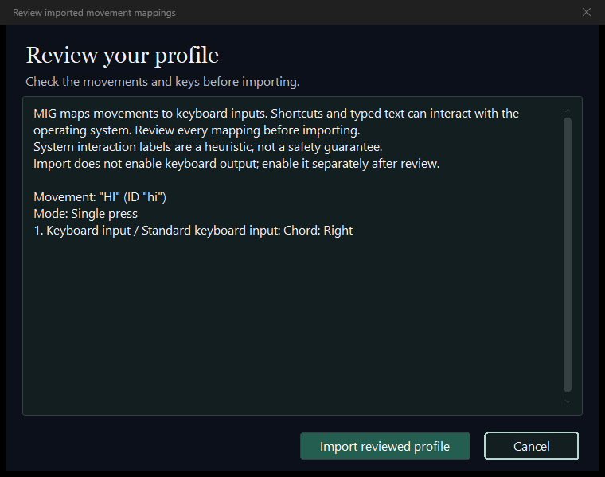

# Commander une présentation

[English](presentations.md) | [Français](presentations.fr.md)

**Télécharger Studio + Controller :** [Windows x64 (zip)](https://github.com/Robin-G0/Motion-Input-Grid/releases/tag/v1.1.0#user-content-mig-v1-1-0-desktop-applications) · [Linux x64 (tar.gz)](https://github.com/Robin-G0/Motion-Input-Grid/releases/tag/v1.1.0#user-content-mig-v1-1-0-desktop-applications).

Avancez dans **Canva, PowerPoint, PDF et autres types de présentations / slideshows**
avec un mouvement volontaire du poignet et les raccourcis clavier du lecteur.
**Aucun code ni modification de JSON nécessaire.** Gardez le clavier accessible.

> [!TIP]
> **Vérifiez d'abord le raccourci avec votre clavier physique.** Ouvrez la présentation
> en mode présentation ou plein écran, cliquez dedans et appuyez sur **Flèche droite**.
> Si elle n'avance pas, utilisez le véritable raccourci suivant du lecteur dans MIG.
> Il dépend du logiciel, du navigateur et du mode d'affichage.

## Dessiner et tester un geste

1. Ouvrez le [Studio web](https://robin-g0.github.io/Motion-Input-Grid/studio/) ou le
   [Studio de bureau](configurator.fr.md). Créez **Diapositive suivante**, avec
   l'action `next_slide`, en suivant le poignet de votre choix.
2. Dessinez une région 🟩 **Required** autour de sa position de repos puis une
   région 🟨 **Trigger** plus haut. Placez-les avec le retour caméra selon votre
   mouvement réel, en gardant les épaules visibles. Évitez les positions atteintes
   naturellement en parlant. Revenez au repos entre deux activations.

## Associer la touche de présentation

1. Dans le Studio web, choisissez **Associer des touches**. Ajoutez une pression,
   choisissez le raccourci vérifié (**Right**, flèche droite, si votre essai a fonctionné)
   et **Une seule fois**, puis **Enregistrer et revenir aux mouvements**.
2. Choisissez **Tester toute la configuration**. Faites votre geste et vérifiez
   l'action et la touche simulée dans le journal.
3. Choisissez **Exporter** pour enregistrer le profil. Le rappel donne accès au
   Controller et au guide illustré.

> [!NOTE]
> Le Studio web **simule** les touches dans son journal. Le **Controller** de bureau
> les envoie à la présentation. Le téléchargement et le guide sont proposés à l'export.

## Importer et répéter

1. **Arrêtez la caméra de l'éditeur**. Ouvrez le [Controller](controller.fr.md) et
   choisissez le fichier exporté avec **Import profile**.
2. Vérifiez le mouvement et sa touche avant de confirmer l'import.

*Exemple réel sous Windows : ce profil s'appelle HI ; le vôtre doit afficher
Diapositive suivante et votre touche. La disposition Linux diffère.*

3. Démarrez le suivi et calibrez à votre position de présentation. Gardez
   **Keyboard output désactivé** jusqu'à ce que seul le mouvement voulu s'allume.
4. Activez la sortie. Ouvrez **Canva, PowerPoint, votre lecteur PDF ou un autre
   outil de présentation / slideshow**, lancez le diaporama et **cliquez dedans**.
5. Faites un geste. Vérifiez qu'il avance à l'animation, diapositive ou page attendue.

> [!WARNING]
> Les touches vont à **l'application au premier plan**. Répétez sur une copie avant
> de présenter en public. **Désactivez la sortie pendant les questions** ou si des
> gestes ordinaires risquent de déclencher le mouvement. Gardez votre clavier accessible.

## Revenir en arrière et choisir son lecteur

Dans PowerPoint, **Flèche droite** avance à l'animation ou diapositive suivante ;
**Flèche gauche** revient à la précédente. Une diapositive animée peut donc
demander plusieurs activations. Consultez les
[raccourcis de diaporama Microsoft](https://support.microsoft.com/en-us/office/use-keyboard-shortcuts-to-deliver-powerpoint-presentations-1524ffce-bd2a-45f4-9a7f-f18b992b93a0).
Pour un autre logiciel, vérifiez d'abord ses raccourcis.

Si nécessaire, créez un mouvement distinct **Diapositive précédente** avec `Left`
(flèche gauche). Gardez les deux parcours distincts et utilisez Single press.
Désactivez la sortie pendant les questions ou lorsque des gestes ordinaires
risquent de déclencher un parcours.

| Que se passe-t-il ? | À essayer |
| --- | --- |
| Aucun mouvement ne s'allume | Gardez les épaules visibles, recalibrez et vérifiez les zones. |
| Le mouvement s'allume mais rien n'avance | Activez la sortie, désactivez **Verify bindings** et cliquez dans la présentation. |
| Plusieurs diapositives avancent | Utilisez **Une seule fois** et revenez au repos. Vérifiez aussi les animations du lecteur. |
