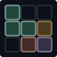

# Motion Input Grid (MIG)

[English](readme.md) | [Français](docs/fr/readme.fr.md)

# [ Explore the presentation website](https://robin-g0.github.io/Motion-Input-Grid/)

Start here for a **quick introduction and an interactive demo of the concept**, directly in your browser.

**Turn a movement into an action.** Draw a route for a wrist or another body part,
then recognize it with a camera. Use the resulting actions in your project or send
keyboard shortcuts to a desktop application.

| Start here | What you can do |
| --- | --- |
| **[Browser Studio / configuration editor](https://robin-g0.github.io/Motion-Input-Grid/studio/)** | Create, import and test a profile, then export JSON. No installation. |
| **Motion Input Grid Controller (desktop)** | [Download for Windows x64 (ZIP)](https://github.com/Robin-G0/Motion-Input-Grid/releases/tag/v1.1.0#user-content-desktop-applications) · [Download for Linux x64 (tar.gz)](https://github.com/Robin-G0/Motion-Input-Grid/releases/tag/v1.1.0#user-content-desktop-applications) — includes Studio for profile editing. |

MIG is in early development. Desktop Linux applications and game-engine
integrations still need wider testing; check the [support matrix](docs/reference/support.md).

> [!WARNING]
> **Windows may not recognize these early executables.** SmartScreen can warn
> about an unfamiliar application. Download from this repository's
> releases and verify the supplied checksums. If you trust that download,
> **More info → Run anyway** may be available. Do not disable Windows protection.

## Use MIG now

1. Create or import a profile in the browser Studio above, or use the
   [desktop Studio](docs/guides/configurator.md). Choose a movement's body part,
   draw its conditions, and assign its action. For desktop shortcuts, add a
   keyboard binding in the Studio JSON editor or desktop Studio.
2. Test with the camera, then export or save the JSON profile. The
   [browser Studio guide](docs/guides/studio-web.md) explains editing and live feedback.
3. Download the Controller above and extract the **whole archive**. Stop the
   Studio's camera, open the Controller and import your JSON.
4. Start tracking and keep both shoulders visible for calibration. Check that
   the movement lights up with **Keyboard output off**, then enable it and focus
   the application you want to control. See the [Controller guide](docs/guides/controller.md).

| **Draw a condition** | **What it means** |
| --- | --- |
| 🟩 Required | Pass through this region; numbers define the order. |
| 🟥 Forbidden | Avoid this region. |
| 🟨 Trigger | Finish the movement here. |
| 🟪 Interaction | Make a hand sign here, optionally holding it. |

These condition names are shared by the web editor, desktop Studio and guides.
The browser shows recognized actions; the Controller can deliver keyboard output.
Desktop archives include camera models and runtime files: keep them together.
Windows requires the [latest Visual C++ x64 runtime](https://aka.ms/vc14/vc_redist.x64.exe); Linux requires glibc 2.35+.
Linux keyboard output needs X11/XTest; native Wayland output is unavailable.

## Use movements in everyday applications

| Situation | Guide |
| --- | --- |
| Advance a PowerPoint presentation | [Presentation controls](docs/guides/presentations.md) |
| Control a game using its existing keyboard bindings | [Video games](docs/guides/video-games.md) |
| Run shortcuts while using your computer | [Everyday computer use](docs/guides/everyday-use.md) |

> [!CAUTION]
> **Check the rules before using the Controller in competitive games.** MIG
> generates operating-system keyboard events; it does not patch games, inject
> code or read their process memory. This does not guarantee acceptance by an
> anti-cheat system: unfamiliar processes or simulated input may be flagged.
> Follow the game's policy and obtain permission where needed. Avoid ranked or
> protected sessions when acceptance is unclear; MIG cannot guarantee protection
> from an account penalty.

## Integrate MIG into your project

Every integration uses the same C++20 recognition engine and JSON profiles.
Supply body landmarks yourself or use an available camera adapter.

For **Python**, install from PyPI:

```sh
python -m pip install motion-input-grid
```

Import `Tracker` from `mig`. The wheel contains the engine for supplied positions;
desktop camera viewers use a separate native runtime.

For **JavaScript / browser projects**, install from npm and copy the runtime assets:

```sh
npm install motion-input-grid
npx mig-copy-assets public/mig
```

The npm package includes WASM, camera models and framework adapters. Serve these
assets from your application and start the camera after a user action.

| Project type | Integration guide |
| --- | --- |
| Python | [Installation, landmarks and action feedback](bindings/python/README.md) |
| JavaScript / HTML | [npm, WASM and camera setup](bindings/javascript/README.md) |
| React / Vue / Next.js | [Framework integration and examples](docs/integrations/javascript.md) |
| C++ / CMake / Make | [SDK and `MIG::core`](docs/getting-started/cpp.md) |
| vcpkg / Debian | [Package installation](docs/getting-started/packages.md) |
| SDL2 / SFML | [Native application integration](docs/integrations/overview.md) |
| .NET / C# | [Managed bridge](bindings/dotnet/README.md) |
| Godot | [Add-on and C# integration](integrations/godot/README.md) |
| Unity | [UPM integration](integrations/unity/README.md) |
| Unreal | [Native plugin](integrations/unreal/README.md) |

Game-engine integrations are **Preview** and require a landmark provider; they do
not bundle desktop camera tracking.

## Advanced downloads

Use pip or npm above for Python and JavaScript dependencies. Downloadable browser
packages are **local example projects**, distinct from the hosted presentation
and Studio: extract them and run their local web server. They are not desktop
applications and cannot send keyboard shortcuts to another application.

| Package | Where to start |
| --- | --- |
| C++ SDK, Debian packages and engine integrations | [Release package catalogue](https://github.com/Robin-G0/Motion-Input-Grid/releases/tag/v1.1.0#user-content-downloads) |
| Standalone native examples and source tutorials | [Example catalogue](examples/README.md) |
| Downloadable HTML / React / Vue / Next.js examples | [Browser example packages](docs/integrations/javascript.md#built-examples-archive) |

Individual browser archives require Node 22.12+; the combined JavaScript examples
archive includes Node. Follow the README inside each package.

## Learn more and contribute


The [documentation](docs/index.md) covers the configuration format, architecture,
APIs, troubleshooting and source builds. Read the [changelog](docs/development/CHANGELOG.md)
or [contribution guide](CONTRIBUTING.md), and report problems through
[GitHub issues](https://github.com/Robin-G0/Motion-Input-Grid/issues).

Licensed under [Apache-2.0](LICENSE). Redistributed dependencies retain their notices.
